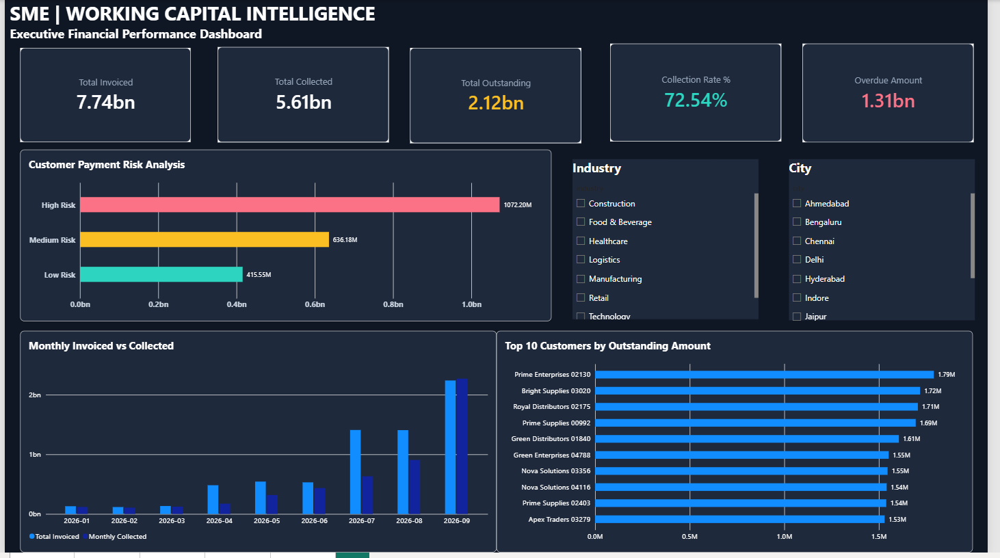
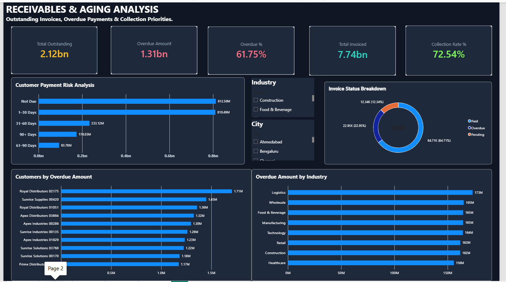
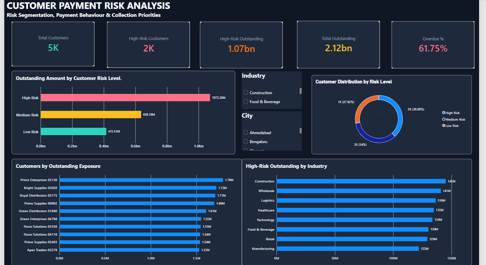
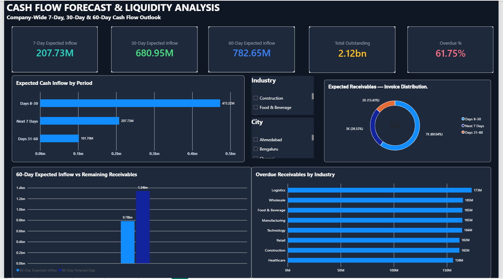
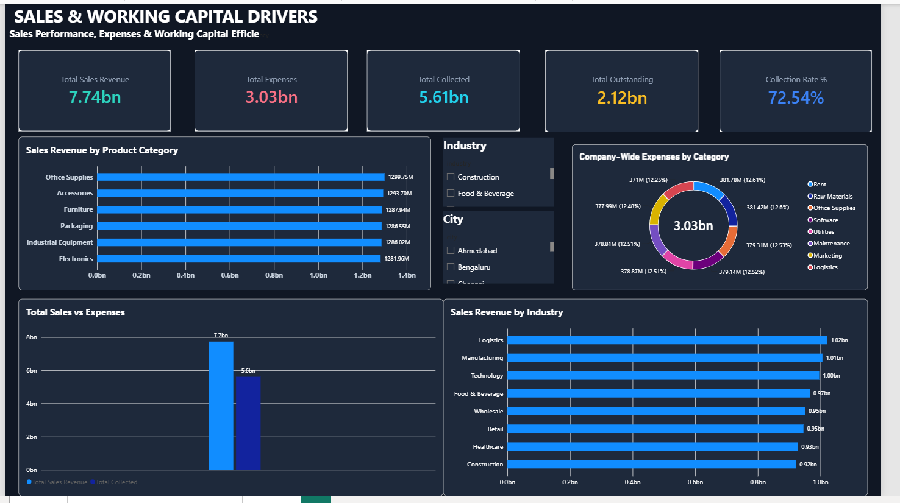

# SME Working Capital & Payment Risk Analytics

### End-to-End Financial Analytics | Python · MySQL · Power BI

An independent, end-to-end Data Analytics portfolio project designed to analyze **accounts receivable, customer payment risk, cash-flow outlooks, and working capital performance** using a simulated Small and Medium Enterprise (SME) dataset.

> **Data Disclaimer:** This project uses entirely synthetic financial data. It is not affiliated with any real company, and the results are illustrative.

## 1. Business Problem

Small and medium enterprises often face challenges in managing outstanding invoices, delayed customer payments, collection priorities, and short-term liquidity.

This project explores five business questions:

1. How much money is outstanding, and how much is overdue?
2. Which customers present the highest payment risk?
3. Which receivables should receive collection attention?
4. What does the company's 7-day, 30-day, and 60-day cash-flow outlook indicate?
5. How do sales, collections, and expenses contribute to working capital performance?

## 2. Technology Stack

| Technology | Application |
|---|---|
| Python | Synthetic data generation, processing, and validation |
| MySQL | Relational database, SQL queries, and analytical views |
| Power BI | Data modeling, DAX measures, interactive dashboards, and KPI reporting |

## 3. Dataset Overview

The project uses five core synthetic financial datasets.

| Dataset | Description |
|---|---|
| Customers | Customer profiles, industries, cities, credit limits, and payment terms |
| Invoices | Invoice amounts, issue dates, due dates, and payment statuses |
| Payments | Full and partial customer payments |
| Sales | Product-level sales transactions and revenue |
| Expenses & Payables | Vendor expenses, payment obligations, and settlement information |

**Approximate dataset scale:**

- 5,000 customers
- 100,000 invoices
- 124,017 payment records
- 199,760 sales records

The datasets are linked through customer and invoice identifiers to support relational analysis.

## 4. Project Workflow

**Python → MySQL → Power BI → Business Insights**

**Step 1 — Data Generation and Preparation**

Generated synthetic customer, invoice, payment, sales, and expense records using Python.

**Step 2 — Database Development**

Organized the datasets in MySQL and developed SQL queries and analytical views for financial reporting.

**Step 3 — Financial Analytics**

Analyzed receivables, overdue balances, payment risk, collections, and working capital indicators.

**Step 4 — Dashboard Development**

Developed a five-page interactive Power BI report with KPI cards, charts, slicers, and DAX measures.

**Step 5 — Dashboard Validation**

Reviewed KPI behavior under industry and city selections and clarified which measures represent company-wide figures.

## 5. Power BI Dashboard

### Page 1 — Executive Overview

Provides a high-level view of financial performance, including receivables, collections, and key working capital indicators.



### Page 2 — Receivables & Aging Analysis

Examines outstanding invoices, overdue receivables, and aging patterns to identify collection concerns.



### Page 3 — Customer Payment Risk Analysis

Analyzes customer risk classifications and outstanding exposure to support collections prioritization.



### Page 4 — Cash Flow Forecast & Liquidity Analysis

Presents company-wide 7-day, 30-day, and 60-day cash-flow outlooks.



### Page 5 — Sales & Working Capital Drivers

Examines sales revenue, customer collections, and company-wide expense categories.



## 6. Key Analytical Outcomes

The project demonstrates how financial transaction data can be used to:

- Identify overdue receivables and monitor collection exposure.
- Segment customers using explainable, rule-based payment risk classifications.
- Compare outstanding balances across customer risk categories.
- Explore company-wide cash-flow outlooks across multiple time horizons.
- Analyze sales and collections by customer segments.
- Present financial KPIs through interactive Power BI dashboards.

**Important interpretation notes:**

- Payment risk categories are rule-based analytical indicators, not independently validated default predictions.
- Cash-flow outlooks are illustrative and company-wide.
- Expense-category figures represent company-wide expenses rather than industry-specific expenses.
- Financial results are based on simulated data and should not be interpreted as actual company performance.

## 7. Repository Structure

```text
SME-Working-Capital-Analytics/
│
├── DATA/
│   ├── customers.csv
│   ├── invoices.csv
│   ├── payments.csv
│   ├── sales.csv
│   ├── expenses_payables_cleaned.csv
│   └── invoice_status_summary.csv
│
├── SQL/
│   ├── original_sql_queries.sql
│   ├── customer_payment_risk_analysis.sql
│   └── database_validation.sql
│
├── PYTHON/
│   ├── generate_data.py
│   ├── generate_invoices_updated.py
│   ├── generate_payments_updated.py
│   ├── generate_sales.py
│   ├── generate_expenses.py
│   ├── calculate_invoice_status.py
│   └── validate_data.py
│
├── POWERBI/
│   └── SME_Working_Capital_Analytics.pbix
│
├── IMAGES/
│   ├── 01_Executive_Overview.png
│   ├── 02_Receivables_Aging_Analysis.png
│   ├── 03_Customer_Payment_Risk.png
│   ├── 04_Cash_Flow_Forecast.png
│   └── 05_Sales_Working_Capital.png
│
├── DOCUMENTATION/
│   └── database_design.md
│
└── README.md
```

## 8. Skills Demonstrated

**Data Analytics:** Financial KPI analysis, receivables aging, customer segmentation, working capital analysis, and dashboard validation.

**SQL:** Relational data analysis, joins, aggregations, analytical queries, and SQL views.

**Python:** Synthetic dataset generation, data preparation, and validation.

**Power BI:** Data modeling, DAX calculations, interactive filtering, financial reporting, and dashboard design.

## 9. Project Limitations

This is a portfolio demonstration built using synthetic financial data.

The analysis does not constitute real financial advice or a production credit-risk assessment. Forecasting outputs depend on simulated assumptions, and final database definitions should be verified against the SQL scripts.

## 10. Conclusion

This project demonstrates an end-to-end financial analytics workflow using Python, MySQL, and Power BI.

It highlights practical Data Analyst skills in relational data analysis, financial KPI development, customer payment risk segmentation, cash-flow reporting, and interactive business intelligence.

---

 
**Domain:** SME Finance & Working Capital Analytics  
**Tools:** Python | MySQL | Power BI  
**Data:** 100% Synthetic